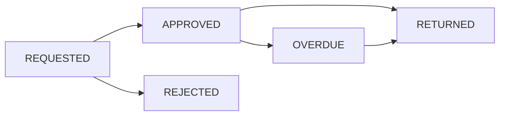

# RoboVault

Inventory & equipment lending API for the robotics club.

## Status

Software Engineering academic project — FastAPI backend with PostgreSQL,
Docker development setup, and CI via GitHub Actions.

## Architecture

```text
app/
├── api/routes/       # HTTP endpoints (thin — no business logic)
│   ├── auth.py       #   POST /register, POST /login
│   ├── items.py      #   CRUD inventory (admin writes, any user reads)
│   ├── loans.py      #   Request / approve / reject / return
│   └── ocr.py        #   POST /parse-bill (admin only)
├── core/
│   ├── config.py     #   Pydantic Settings (env-driven)
│   └── security.py   #   bcrypt hashing, JWT create/decode
├── db/
│   ├── base.py       #   SQLAlchemy declarative base
│   └── session.py    #   Engine + get_db dependency
├── models/           #   SQLAlchemy ORM models
│   ├── user.py       #     User (ADMIN / MEMBER / GUEST)
│   ├── item.py       #     Item (inventory with quantity tracking)
│   ├── loan.py       #     Loan (request → approved → returned)
│   └── bill.py       #     BillUpload (OCR scan records)
├── ocr/
│   ├── preprocess.py #   Image normalization for Tesseract
│   └── parser.py     #   Regex line-item extraction
├── schemas/          #   Pydantic request/response models
│   ├── user.py       #     UserCreate, UserRead, Token
│   ├── item.py       #     ItemCreate, ItemUpdate, ItemRead
│   └── loan.py       #     LoanRequest, LoanRead
├── services/
│   ├── files.py      #   Photo upload helper
│   └── lending.py    #   Business rules (stock checks, overdue flag)
└── main.py           #   FastAPI app factory
```

## Tech Stack

| Layer | Technology |
|-------|-----------|
| Framework | FastAPI 0.141 |
| Database | PostgreSQL 16 (Docker) |
| ORM | SQLAlchemy 2.0 (mapped columns) |
| Migrations | Alembic |
| Auth | bcrypt + python-jose JWT |
| OCR | Tesseract + Pillow + OpenCV |
| Testing | pytest + pytest-cov |
| Linting | ruff + black |
| CI | GitHub Actions |
| Containerization | Docker + Docker Compose |

## Quick Start

Use Python 3.11+, Docker with Compose, and Tesseract for real OCR. On Ubuntu, install the OCR executable with `sudo apt-get install tesseract-ocr`; Python packages alone do not provide it. The Docker image includes Tesseract.

### 1. Clone and set up

```bash
git clone https://github.com/SuhanVerse/RoboVault.git
cd RoboVault
python3 -m venv .venv
source .venv/bin/activate
python -m pip install -r requirements.txt
[ -e .env ] || cp .env.example .env
```

The example configuration uses a local database and a development signing key. Keep your own `.env` private and replace the signing key before exposing the service.

### 2. Start the database

```bash
docker compose up -d db
```

Wait for healthy status:

```bash
docker compose ps   # STATUS should say "(healthy)"
```

### 3. Apply database migrations

```bash
alembic upgrade head
```

### 4. Start the server

```bash
uvicorn app.main:app --reload --port 8000
```

Open **http://localhost:8000/docs** for the interactive Swagger UI.

To run the API in Docker instead of the local virtual environment, start the healthy database as above, then run:

```bash
docker compose build app
docker compose run --rm app alembic upgrade head
docker compose up -d app
```

Migrations are explicit; starting the container alone does not create the schema.

## API Reference

Interactive docs: open http://localhost:8000/docs (Swagger UI) or /redoc.

### Authentication

```bash
# Register a new account (default role: GUEST)
curl -X POST http://localhost:8000/api/v1/auth/register \
  -H "Content-Type: application/json" \
  -d '{"name":"Ali","email":"ali@club.edu","password":"secret123"}'

# Login and get a JWT token
curl -X POST http://localhost:8000/api/v1/auth/login \
  -H "Content-Type: application/json" \
  -d '{"email":"ali@club.edu","password":"secret123"}'
# → {"access_token": "...", "token_type": "bearer"}
```

### Inventory (items)

```bash
# List all items (requires any authenticated user)
curl http://localhost:8000/api/v1/items \
  -H "Authorization: Bearer <token>"

# Create an item (ADMIN only)
curl -X POST http://localhost:8000/api/v1/items \
  -H "Authorization: Bearer <admin_token>" \
  -F "name=Motors" \
  -F "category=electronics" \
  -F "quantity_total=10" \
  -F "unit_price=25.00" \
  -F "source=MANUAL"
```

### Lending (loans)

```bash
# Request a loan (any authenticated user)
curl -X POST http://localhost:8000/api/v1/loans/request \
  -H "Authorization: Bearer <token>" \
  -H "Content-Type: application/json" \
  -d '{"item_id": 1, "quantity": 2, "due_date": "2027-01-31"}'

# Approve a loan (ADMIN only)
curl -X PUT http://localhost:8000/api/v1/loans/1/approve \
  -H "Authorization: Bearer <admin_token>"

# Return a loan (ADMIN only)
curl -X PUT http://localhost:8000/api/v1/loans/1/return \
  -H "Authorization: Bearer <admin_token>"
```

### OCR (bill scanning)

```bash
# Parse a bill image → suggestions (ADMIN only)
curl -X POST http://localhost:8000/api/v1/ocr/parse-bill \
  -H "Authorization: Bearer <admin_token>" \
  -F "file=@bill_photo.jpg"
# → {"id": 1, "status": "PROCESSED", "suggestions": [...]}
```

### Health Check

```bash
curl http://localhost:8000/health
# → {"status": "ok"}
```

## Endpoints Summary

| Method | Path | Auth | Description |
|--------|------|------|-------------|
| POST | `/api/v1/auth/register` | None | Create account |
| POST | `/api/v1/auth/login` | None | Get JWT token |
| GET | `/api/v1/items` | Any user | List inventory |
| POST | `/api/v1/items` | ADMIN | Create item |
| GET | `/api/v1/items/{id}` | Any user | Get item details |
| PUT | `/api/v1/items/{id}` | ADMIN | Update item |
| DELETE | `/api/v1/items/{id}` | ADMIN | Delete item |
| POST | `/api/v1/loans/request` | Any user | Request a loan |
| PUT | `/api/v1/loans/{id}/approve` | ADMIN | Approve loan |
| PUT | `/api/v1/loans/{id}/reject` | ADMIN | Reject loan |
| PUT | `/api/v1/loans/{id}/return` | ADMIN | Return loan |
| POST | `/api/v1/ocr/parse-bill` | ADMIN | Parse bill image |
| GET | `/health` | None | Health check |

## Roles & Permissions

| Role | Can do |
|------|--------|
| **ADMIN** | Full access — create/edit/delete items, approve/reject/return loans, run OCR |
| **MEMBER** | Read items, request loans |
| **GUEST** | Read items and request loans (default on registration) |

Loan requests start as `REQUESTED`. Approval reduces available stock; rejection ends the request. An approved or overdue loan can be returned to restore stock.



## Running Tests

```bash
pytest --cov=app --cov-report=term --cov-report=html
# Open htmlcov/index.html for the HTML coverage report
```

Tests use a separate PostgreSQL database with a `_test` suffix and clear its tables between tests; never point `TEST_DATABASE_URL` at data you need. OCR calls are mocked in the API suite, so coverage does not measure real image-reading accuracy. Actual OCR returns suggestions for review and does not create inventory automatically.

## Project Structure

```text
RoboVault/
├── app/                 # Application source code
├── alembic/             # Database migrations
├── tests/               # Test suite
├── .github/workflows/   # CI checks
├── docker-compose.yml   # Container orchestration
├── Dockerfile           # App container image
├── requirements.txt     # Python dependencies
├── pyproject.toml       # Tool configuration (ruff, black, pytest)
└── README.md            # This file
```

## Team

Developed as a Software Engineering team project. See the [contributor history](https://github.com/SuhanVerse/RoboVault/graphs/contributors) for recorded code contributions.

## License

[GNU General Public License v3.0](LICENSE).
